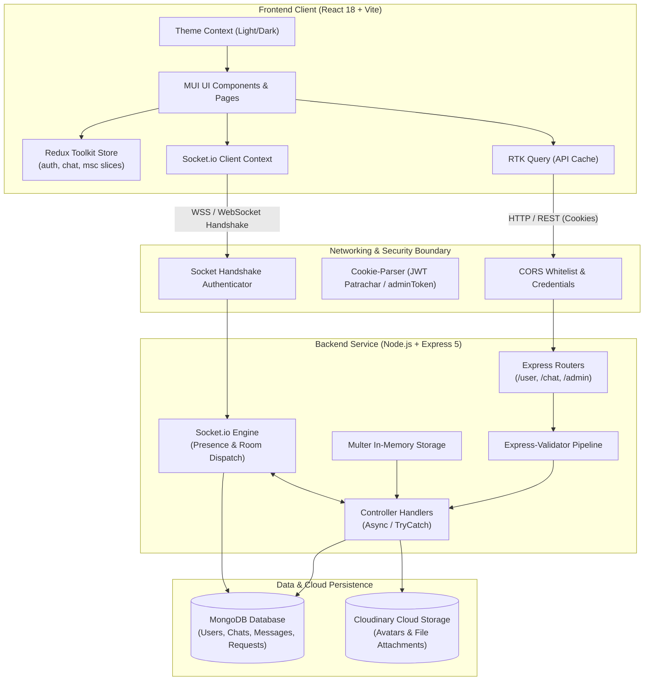
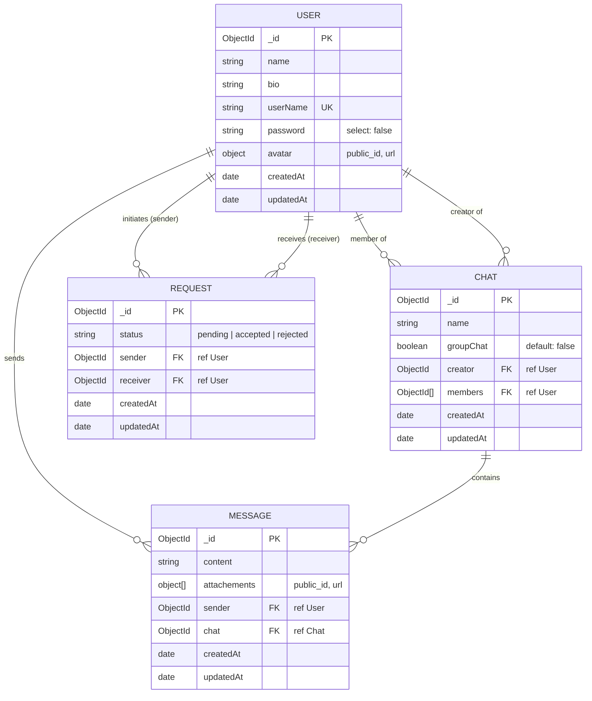
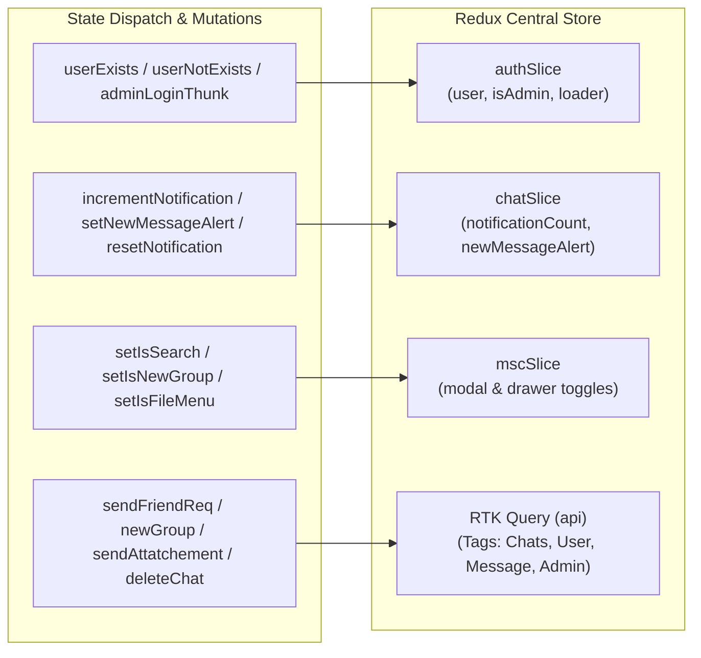

# 💬 Patrachar (Chattu) - Full-Stack Real-Time Communication Platform

[](https://react.dev/)
[](https://mui.com/)
[](https://redux-toolkit.js.org/)
[](https://nodejs.org/)
[](https://socket.io/)
[](https://www.mongodb.com/)
[](https://cloudinary.com/)

---

## 📖 Table of Contents

- [Overview](#-overview)
- [Key Features](#-key-features)
- [System Architecture](#-system-architecture)
  - [High-Level Architecture Diagram](#high-level-architecture-diagram)
  - [Request & Real-Time Flow](#request--real-time-flow)
- [Backend Architecture](#-backend-architecture)
  - [Core Server Technologies](#core-server-technologies)
  - [Authentication & Security](#authentication--security)
  - [Database Schemas & Data Models](#database-schemas--data-models)
  - [Cloud Media Management](#cloud-media-management)
  - [Error Handling & Validation Pipeline](#error-handling--validation-pipeline)
- [Frontend Architecture](#-frontend-architecture)
  - [Component Architecture & Layout System](#component-architecture--layout-system)
  - [State Management: Redux Toolkit & RTK Query](#state-management-redux-toolkit--rtk-query)
  - [Socket Context & Real-Time Client Synchronization](#socket-context--real-time-client-synchronization)
  - [Theming & Design System (Light/Dark Mode)](#theming--design-system-lightdark-mode)
  - [Admin Analytics & Management Dashboard](#admin-analytics--management-dashboard)
- [Real-Time WebSocket Protocol Matrix](#-real-time-websocket-protocol-matrix)
- [REST API Specification](#-rest-api-specification)
  - [User Routes (`/api/v1/user`)](#user-routes-apiv1user)
  - [Chat Routes (`/api/v1/chat`)](#chat-routes-apiv1chat)
  - [Admin Routes (`/api/v1/admin`)](#admin-routes-apiv1admin)
- [Project Directory Structure](#-project-directory-structure)
- [Environment Configuration](#-environment-configuration)
  - [Server Environment Variables (`server/.env`)](#server-environment-variables-serverenv)
  - [Client Environment Variables (`client/.env`)](#client-environment-variables-clientenv)
- [Installation & Local Setup](#-installation--local-setup)
- [Production Deployment & QA Status](#-production-deployment--qa-status)

---

## 🌟 Overview

**Patrachar** (internally designated as *Chattu*) is an enterprise-grade, full-stack real-time collaboration and instant messaging web platform. Engineered on a decoupled client-server architecture, Patrachar supports direct 1-on-1 messaging, scalable group chats, multimedia file attachments with cloud storage offloading, user presence tracking, interactive typing notifications, and an administrative control panel with live analytics and audit tables.

The system is built with high performance, strict type validation, cookie-based session security, and responsive UI accessibility in mind.

---

## ⚡ Key Features

- **1-on-1 & Group Chats**: Seamlessly communicate directly with friends or create groups with up to 100 members.
- **Real-Time Synchronicity**: Sub-millisecond bidirectional messaging and live event broadcasting powered by Socket.io.
- **Active Presence & Typing Indicators**: Real-time online/offline indicators and debounced user typing loaders.
- **Multimedia File Sharing**: Send images, audio clips, videos, and raw document attachments via Multer memory streaming and Cloudinary CDN storage.
- **Infinite Scroll Message History**: Optimized reverse-chronological pagination using dynamic top-scroll pagination (`useInfiniteScrollTop`).
- **Friend Request & Notification Pipeline**: Search non-friend users across the platform, send requests, accept/reject invites, and receive live notification badges.
- **Granular Group Controls**: Group creators can modify group names, add new members, remove members, or transfer ownership automatically upon leaving.
- **Admin Control Center**:
  - Protected administrative console with dedicated secret key authorization.
  - Interactive visualization charts (Chart.js line chart for 7-day message traffic, doughnut chart for group vs. single chat distribution).
  - High-performance data tables (`@mui/x-data-grid`) for user, conversation, and message audits.
- **Adaptive Theme System**: Integrated Material-UI dynamic light/dark theme switcher persisted in browser storage.

---

## 🏗 System Architecture

### High-Level Architecture Diagram



### Request & Real-Time Flow

1. **Authentication Flow**: User submits credentials $\rightarrow$ server hashes with `bcrypt` / verifies with JWT $\rightarrow$ issues an `httpOnly`, `SameSite` signed cookie (`Patrachar`) $\rightarrow$ client automatically attaches cookie to subsequent REST and WebSocket requests.
2. **WebSocket Handshake**: Socket client connects with `withCredentials: true` $\rightarrow$ `socketAuthenticator` intercepts cookie on handshake $\rightarrow$ verifies JWT $\rightarrow$ extracts user document from MongoDB $\rightarrow$ registers user in `userSocketIDs` mapping $\rightarrow$ joins session.
3. **Real-Time Message Dispatch**:
   - Client emits `NEW_MESSAGE` with `chatId`, `message`, and `members`.
   - Socket server saves message to MongoDB.
   - Socket server finds recipient socket IDs via `getSockets(members)` helper.
   - Emits `NEW_MESSAGE` to online chat participants and `NEW_MESSAGE_ALERT` for badge increments.

---

## 🖥 Backend Architecture

Located in `/server`, the backend is built using modern ES Modules (`type: "module"`).

```
server/
├── constants/
│   ├── config.js          # CORS whitelist and cookie constants
│   └── event.js           # Shared Socket.io event name constants
├── controllers/
│   ├── admin.js           # Admin auth, dashboard metrics, data inspection
│   ├── chat.js            # Group lifecycle, messaging, media attachment, pagination
│   └── user.js            # Auth, profile, search, friend request workflows
├── lib/
│   ├── helper.js          # Base64 converters, socket resolver, member filters
│   └── validators.js      # Express-validator validation chains
├── middlewares/
│   ├── auth.js            # isAuthenticated, adminOnly, socketAuthenticator
│   ├── error.js           # TryCatch async wrapper & global error handler
│   └── multer.js          # In-memory single avatar and multi-attachment upload
├── models/
│   ├── chat.js            # Chat document schema (members, creator, groupChat flag)
│   ├── message.js         # Message document schema (attachments, sender, chat)
│   ├── request.js         # Friend request schema (status, sender, receiver)
│   └── user.js            # User profile schema with bcrypt pre-save hash hook
├── routes/
│   ├── admin.js           # /api/v1/admin
│   ├── chat.js            # /api/v1/chat
│   └── user.js            # /api/v1/user
├── seeders/
│   ├── chat.js            # Mock chat generator using @faker-js/faker
│   └── user.js            # Mock user generator
├── utils/
│   ├── features.js        # MongoDB connector, Cloudinary uploaders, token sender
│   └── utility.js         # Custom ErrorHandler class
├── app.js                 # HTTP & Socket.io server bootstrap and entry point
├── package.json
└── .env                   # Environment configurations
```

### Core Server Technologies

- **Runtime**: Node.js
- **Web Framework**: Express.js (v5)
- **Real-Time Communication**: `socket.io` (v4)
- **Database Object Modeling**: Mongoose (v8) with MongoDB
- **File Upload Engine**: Multer (memory storage)
- **Cloud Media Provider**: Cloudinary SDK (v2)

### Authentication & Security

1. **Password Hashing**:
   - Standardized on `bcrypt` with 10 salt rounds.
   - Handled transparently in a Mongoose `pre("save")` hook on the `User` schema.
   - User password field marked with `select: false` to avoid leaking hashes in query projections.
2. **JWT-Cookie Architecture**:
   - Stateless JWT tokens signed with `JWT_SECRET`.
   - Sent via hardened HTTP-only cookies (`maxAge: 15 days` for users; `15 minutes` for admin session).
   - In `PRODUCTION`: `sameSite: "none"` and `secure: true`.
   - In `DEVELOPMENT`: `sameSite: "lax"` and `secure: false`.
3. **CORS Hardening**:
   - Origin verification against a designated whitelist (`http://localhost:5173`, `http://localhost:5174`, `https://patrachar.netlify.app`).
   - Supports `credentials: true` for cross-site cookie transmission.

### Database Schemas & Data Models



### Cloud Media Management

- Avatars and chat files are staged in RAM buffer via `multer.memoryStorage()`.
- Helper `getBase64(file)` creates Data URI strings transmitted in parallel batches to Cloudinary (`uploadFilesToCloudinary`) using `Promise.all`.
- Uploaded assets are tagged and isolated inside the dedicated `"Patrachar"` Cloudinary folder.
- When chats are deleted, all associated message attachment `public_id` values are aggregated and purged from Cloudinary storage.

### Error Handling & Validation Pipeline

- **`ErrorHandler` Class**: Extends JavaScript's native `Error` with custom HTTP status codes.
- **`TryCatch` Wrapper**: Higher-order function eliminating redundant `try/catch` boilerplate across async controllers.
- **`errorMiddleware`**: Centralized Express middleware standardizing error payloads into structured JSON responses:
  ```json
  {
    "success": false,
    "message": "Error description"
  }
  ```
- **Validation Chains**: Powered by `express-validator`. Input sanitization and format verification happen before controllers are invoked; validation errors short-circuit immediately with HTTP 400.

---

## 💻 Frontend Architecture

Located in `/client`, the client is a Single-Page Application (SPA) built on React 18, bundled with Vite using the `@vitejs/plugin-react-swc` compiler.

```
client/
├── src/
│   ├── assets/                # Static images and icons
│   ├── componenets/           # UI Component hierarchy
│   │   ├── auth/              # Protected route wrappers (ProtectRout.jsx)
│   │   ├── Dialog/            # Modal dialogs (AddMember, ConfirmDelete, DeleteChatMenu, FileMenu)
│   │   ├── layout/            # Layout wrappers (Applayout.jsx, AdminLayout.jsx, Header, Loaders)
│   │   ├── shared/            # Reusable widgets (AvatarCard, ChatItem, MessageComponent, RenderAttachment, Table, Title, USerItem)
│   │   ├── specific/          # Domain-specific components (Charts, ChatList, NewGroups, Notifications, Profile, Search)
│   │   └── styled/            # Styled Emotion components (InputBox, CurveButton, SearchField)
│   ├── contants/              # Client constants (color palettes, API base URLs, socket events, navigation routes)
│   ├── context/               # React Contexts (ThemeModeContext, theme tokens)
│   ├── hooks/                 # Custom React hooks (useErrors, useMutationHokk, useSocketEvents)
│   ├── lib/                   # Utility helpers & localStorage serialization
│   ├── pages/                 # Top-level view routes
│   │   ├── admin/             # Admin console (AdminLogin, Dashboard, ChatsManagement, UserManagement, MessageManagement)
│   │   ├── Chat.jsx           # Real-time messaging conversation view
│   │   ├── Groups.jsx         # Group management and member administration view
│   │   ├── Home.jsx           # Landing/empty chat state
│   │   ├── Login.jsx          # User signup and login view
│   │   └── NotFound.jsx       # 404 handler
│   ├── redux/
│   │   ├── api/               # RTK Query API service (api.js)
│   │   ├── reducer/           # Redux slices (auth, chat, msc)
│   │   ├── thunk/             # Async thunks (admin)
│   │   └── store.js           # Central Redux store configuration
│   ├── socket.jsx             # SocketProvider component
│   ├── socketContext.js       # React context for Socket.io instance
│   ├── App.jsx                # Route definitions & top-level layout composition
│   └── main.jsx               # Application root bootstrap
├── index.html
├── vite.config.js
└── package.json
```

### Component Architecture & Layout System

1. **Higher-Order Component Layout (`AppLayout`)**:
   - Wraps standard user routes (`/`, `/chat/:chatID`, `/groups`).
   - Renders top navigation `Header`, responsive collapsible sidebar (`ChatList`), main active chat viewport, and user `Profile` pane.
   - Listens globally for background real-time events (`NEW_MESSAGE_ALERT`, `NEW_REQUEST`, `ONLINEUSER`, `REFETCH_CHATS`).
2. **Administration Layout (`AdminLayout`)**:
   - Manages desktop and mobile drawer navigation across analytical tabs (`Dashboard`, `Users`, `Chats`, `Messages`).
   - Enforces administrative authentication guard checks.
3. **Protected Routing (`ProtectedRoute`)**:
   - Intercepts navigation based on `user` and `isAdmin` states from Redux.
   - Redirects unauthenticated traffic to `/login` or unauthorized admin access to `/admin`.

### State Management: Redux Toolkit & RTK Query



- **`api.js` (RTK Query)**:
  - Manages server cache lifecycle with automated tag invalidation (`providesTags` & `invalidatesTags`).
  - Queries: `myChats`, `getMyGroups`, `searchUser`, `getNotification`, `getChatDetails`, `availableFriends`, `getMyMessages`.
  - Mutations: `sendFriendReq`, `acceptFriendReq`, `updateGroupName`, `sendAttatchement`, `newGroup`, `removeGroupMember`, `addGroupMember`, `deleteChat`, `leaveGroup`, `getAdminDashboardStats`.
- **`chatSlice`**:
  - Handles client-side unread notification badge counters.
  - Maintains `newMessageAlert` per chat ID with automatic synchronization to `localStorage`.
- **`mscSlice`**:
  - Controls dialog visibility across modals: New Group, Add Member, Notification Drawer, Search Drawer, File Menu, Delete Confirmation, and file upload spinners.

### Socket Context & Real-Time Client Synchronization

- **`SocketProvider` (`socket.jsx`)**: Instantiates a single memoized `io(server)` instance configured with `transports: ["websocket"]` and `withCredentials: true`.
- **`useSocketEvents` Hook**:
  ```javascript
  useSocketEvents(socket, {
    [NEW_MESSAGE]: newMessagesHandler,
    [START_TYPING]: startTypingListener,
    [STOP_TYPING]: stopTypingListener,
    [ALERT]: newAlertListener,
  });
  ```
  Declaratively binds event handlers on mount and automatically unbinds listeners on unmount, preventing memory leaks and event listener duplication.
- **Top-Scroll Pagination (`useInfiniteScrollTop`)**: Dynamically triggers historical message chunk loading from the server when users scroll towards older conversation history.

### Theming & Design System (Light/Dark Mode)

- Built using Material-UI v6 `createTheme` and `ThemeProvider`.
- Implements semantic color scales for light (`#f8fafc` background) and dark (`#0f172a` background) palettes.
- Stores preference in `localStorage` under `patrachar-theme-mode`.
- Accessible theme toggle controls located directly in the application `Header`.

### Admin Analytics & Management Dashboard

- **Dashboard**:
  - Stat cards: Total Users, Total Chats, Total Groups, Total Messages.
  - Interactive **Line Chart**: 7-day conversation message frequency.
  - Interactive **Doughnut Chart**: Ratio of direct private chats vs. multi-user group chats.
- **Data Management**:
  - User Grid: Avatar, Name, Username, Friend Count, Group Count.
  - Chat Grid: Avatar collage, Group Name, Member Count, Total Messages, Creator.
  - Message Grid: Attachment previews, Message Content, Sender Avatar & Name, Chat ID, Timestamp.

---

## 📡 Real-Time WebSocket Protocol Matrix

| Event Name | Direction | Payload Structure | Description |
|---|---|---|---|
| `NEW_MESSAGE` | Bidirectional | `{ chatId, message, members }` | Transmits a new text or attachment message in real time to all chat participants. |
| `NEW_MESSAGE_ALERT` | Server $\rightarrow$ Client | `{ chatId }` | Notifies recipients who do not have the active chat open to increment unread count. |
| `START_TYPING` | Bidirectional | `{ members, chatId }` | Broadcasts active user typing status to other participants in the chat. |
| `STOP_TYPING` | Bidirectional | `{ members, chatId }` | Broadcasts user typing cessation (debounced after 2000ms idle). |
| `CHAT_JOINED` | Client $\rightarrow$ Server | `{ userId, members }` | Registers active conversation focus and updates online presence. |
| `CHAT_LEAVED` | Client $\rightarrow$ Server | `{ userId, members }` | Deregisters active focus and refreshes presence status. |
| `ONLINEUSER` | Server $\rightarrow$ Client | `string[]` (Array of active User IDs) | Broadcasts list of currently connected user IDs. |
| `ALERT` | Server $\rightarrow$ Client | `{ message, chatId }` | Emits system alerts (e.g., group creation, member added/removed, user left). |
| `REFETCH_CHATS` | Server $\rightarrow$ Client | `null` | Instructs the client to invalidate chat list cache and refetch recent conversations. |
| `NEW_REQUEST` | Server $\rightarrow$ Client | `null` | Alerts the recipient that a new friend request has been received. |

---

## 🔌 REST API Specification

### User Routes (`/api/v1/user`)

| Method | Endpoint | Auth Required | Description |
|---|---|---|---|
| `POST` | `/api/v1/user/new` | No | Register a new user account with single avatar image upload. |
| `POST` | `/api/v1/user/login` | No | Authenticate user credentials and return `Patrachar` cookie. |
| `GET` | `/api/v1/user/me` | Yes (`Patrachar`) | Retrieve profile details of currently authenticated user. |
| `GET` | `/api/v1/user/logout` | Yes (`Patrachar`) | Invalidate session cookie and log user out. |
| `GET` | `/api/v1/user/search?name=` | Yes (`Patrachar`) | Search for users by name excluding friends and self. |
| `PUT` | `/api/v1/user/send-request` | Yes (`Patrachar`) | Send a friend request to a target user ID. |
| `PUT` | `/api/v1/user/accept-request`| Yes (`Patrachar`) | Accept or reject an incoming friend request. |
| `GET` | `/api/v1/user/allNotifications` | Yes (`Patrachar`) | Retrieve pending friend requests received by the user. |
| `GET` | `/api/v1/user/friends` | Yes (`Patrachar`) | List user's friends; optionally filters friends not yet in `chatId`. |

### Chat Routes (`/api/v1/chat`)

| Method | Endpoint | Auth Required | Description |
|---|---|---|---|
| `POST` | `/api/v1/chat/new` | Yes (`Patrachar`) | Create a new group chat with name and member ID array. |
| `GET` | `/api/v1/chat/my` | Yes (`Patrachar`) | Retrieve all active 1-on-1 and group chats for current user. |
| `GET` | `/api/v1/chat/my/groups` | Yes (`Patrachar`) | Retrieve group chats created by the current user. |
| `PUT` | `/api/v1/chat/addMembers` | Yes (`Patrachar`) | Add new member IDs to an existing group chat (creator only). |
| `PUT` | `/api/v1/chat/removeMembers`| Yes (`Patrachar`) | Remove a member ID from a group chat (creator only). |
| `DELETE`| `/api/v1/chat/leave/:id` | Yes (`Patrachar`) | Leave a group chat (reassigns creator randomly if creator leaves). |
| `POST` | `/api/v1/chat/message` | Yes (`Patrachar`) | Upload up to 5 file attachments and broadcast as message. |
| `GET` | `/api/v1/chat/message/:id?page=&limit=` | Yes (`Patrachar`) | Paginated message history retrieval for a specific chat. |
| `GET` | `/api/v1/chat/:id` | Yes (`Patrachar`) | Fetch metadata for a specific chat (optional `?populate=true`). |
| `PUT` | `/api/v1/chat/:id` | Yes (`Patrachar`) | Rename a group chat (creator only). |
| `DELETE`| `/api/v1/chat/:id` | Yes (`Patrachar`) | Delete an entire chat and associated messages/cloud files. |

### Admin Routes (`/api/v1/admin`)

| Method | Endpoint | Auth Required | Description |
|---|---|---|---|
| `POST` | `/api/v1/admin/verify` | No | Verify admin secret key and return `adminToken` cookie. |
| `GET` | `/api/v1/admin/logout` | No | Clear `adminToken` session cookie. |
| `GET` | `/api/v1/admin/` | Yes (`adminToken`)| Verify if current session is an authenticated admin. |
| `GET` | `/api/v1/admin/users` | Yes (`adminToken`)| Retrieve all system users with group and friend counts. |
| `GET` | `/api/v1/admin/chats` | Yes (`adminToken`)| Retrieve all system chats with message counts and member lists. |
| `GET` | `/api/v1/admin/messages` | Yes (`adminToken`)| Retrieve all platform messages with attachment details. |
| `GET` | `/api/v1/admin/stats` | Yes (`adminToken`)| Calculate dashboard metrics and 7-day message volume charts. |

---

## 🗂 Project Directory Structure

```text
chattu/
├── client/                     # Frontend React 18 Application (Vite)
│   ├── public/                 # Static assets (favicons, icons)
│   ├── src/                    # Source files
│   │   ├── componenets/        # Modals, layouts, shared widgets, and specific views
│   │   ├── contants/           # Configurations, themes, event identifiers, route names
│   │   ├── context/            # React Theme Context (Light/Dark mode)
│   │   ├── hooks/              # Custom hooks (useErrors, useSocketEvents, useMutationHokk)
│   │   ├── lib/                # Feature utilities & storage abstractions
│   │   ├── pages/              # Chat, Home, Login, Groups, and Admin pages
│   │   ├── redux/              # Redux slices, async thunks, and RTK Query endpoints
│   │   ├── App.jsx             # Top-level route setup
│   │   ├── main.jsx            # Application entry point
│   │   ├── socket.jsx          # Socket.io provider
│   │   └── socketContext.js    # Socket.io context hook
│   ├── .env                    # Frontend environment configurations
│   ├── package.json            # Frontend dependencies & scripts
│   └── vite.config.js          # Vite build configuration
│
├── server/                     # Backend API & WebSocket Engine (Node/Express)
│   ├── constants/              # CORS rules and Socket event constants
│   ├── controllers/            # User, Chat, and Admin business logic
│   ├── lib/                    # Validation rules and helper functions
│   ├── middlewares/            # Authentication, Multer, and Error handlers
│   ├── models/                 # Mongoose schemas (User, Chat, Message, Request)
│   ├── routes/                 # Express REST endpoint declarations
│   ├── seeders/                # Database seed scripts for test data
│   ├── utils/                  # Cloudinary integration, DB connection, and utility errors
│   ├── app.js                  # Express and Socket.io server bootstrap
│   ├── .env                    # Backend secret configurations
│   └── package.json            # Backend dependencies & scripts
│
├── notes.txt                   # Project development scratch notes
├── QA_REPORT.md                # Quality assurance and regression report
└── README.md                   # Complete architectural and setup documentation
```

---

## ⚙️ Environment Configuration

### Server Environment Variables (`server/.env`)

Create a `.env` file inside the `server/` directory:

```env
# Application Port
PORT=3000

# Server Environment Mode (DEVELOPMENT | PRODUCTION)
NODE_ENV=DEVELOPMENT

# MongoDB Connection String
MONGO_URI=mongodb+srv://<username>:<password>@cluster0.mongodb.net/?retryWrites=true&w=majority

# JSON Web Token Secret
JWT_SECRET=your_super_secret_jwt_key_here

# Admin Access Secret
ADMIN_SECRET_KEY=chattuAdmin@123

# Cloudinary Storage Credentials
CLOUDINARY_CLOUD_NAME=your_cloudinary_cloud_name
CLOUDINARY_API_KEY=your_cloudinary_api_key
CLOUDINARY_API_SECRET=your_cloudinary_api_secret
```

### Client Environment Variables (`client/.env`)

Create a `.env` file inside the `client/` directory:

```env
# Backend Server Base URL
VITE_SERVER=http://localhost:3000
```

---

## 🚀 Installation & Local Setup

### Prerequisites

- **Node.js**: v18.x or v20.x or higher
- **npm**: v9.x or higher
- **MongoDB**: A running local instance or MongoDB Atlas cluster URI
- **Cloudinary Account**: Free-tier cloud name, API key, and API secret

### 1. Clone the Repository

```bash
git clone https://github.com/Dhruv-Khare/ChatAPP-Project.git
cd ChatAPP-Project
```

### 2. Setup and Run the Backend Server

```bash
# Navigate to server directory
cd server

# Install dependencies
npm install

# Start in development mode (with nodemon)
npm run dev
```

*The backend server will initialize on `http://localhost:3000`.*

### 3. Setup and Run the Frontend Client

In a separate terminal window:

```bash
# Navigate to client directory
cd client

# Install dependencies
npm install

# Start development server
npm run dev
```

*The frontend development server will launch on `http://localhost:5173`.*

---

## 🛡 Production Deployment & QA Status

- **Frontend Production Build**: Built and optimized via Vite SWC (`npm run build`). Generates static assets in `client/dist`.
- **Lint Verification**: ESLint checks pass with 0 errors (`npm run lint`).
- **Backend Syntax Sweep**: All ES modules pass Node syntax inspection checks (`node --check`).
- **Production Server Startup**:
  ```bash
  npm --prefix server run start
  ```
- **Deployment Reference**:
  - Live Frontend: [https://patrachar.netlify.app](https://patrachar.netlify.app)
  - Backend Host: Production Node.js server with HTTPS support and reverse proxy compatibility.

---

## 📄 License

This project is licensed under the [ISC License](file:///c:/backup/dhruv/patrachar/chattu/server/package.json#L17).

