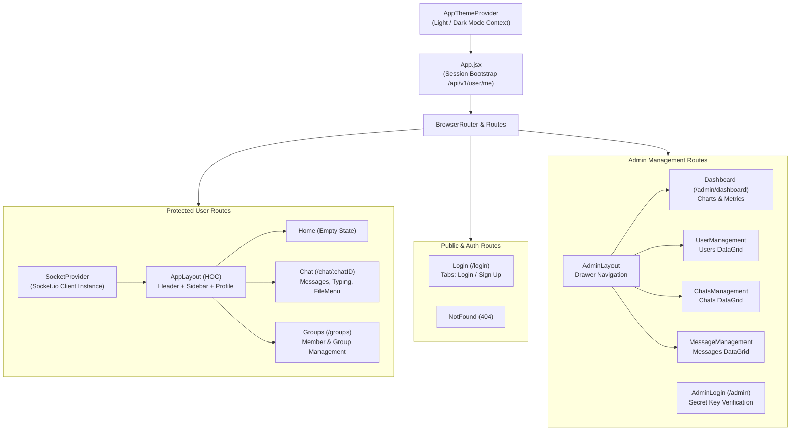

# 💻 Patrachar Frontend Client

[](https://react.dev/)
[](https://vitejs.dev/)
[](https://mui.com/)
[](https://redux-toolkit.js.org/)
[](https://socket.io/)

A modern, responsive, and feature-rich Single Page Application (SPA) for the **Patrachar** real-time messaging platform. Built with **React 18**, **Vite (SWC)**, **Material-UI (MUI v6)**, **Redux Toolkit + RTK Query**, and **Socket.io Client**.

---

## 📑 Table of Contents

- [Features](#-features)
- [Architecture Overview](#-architecture-overview)
  - [Application Flow & Layout System](#application-flow--layout-system)
  - [Component Hierarchy](#component-hierarchy)
- [State Management Architecture](#-state-management-architecture)
  - [Redux Slices](#redux-slices)
  - [RTK Query Service (`api.js`)](#rtk-query-service-apijs)
  - [Admin Async Thunks](#admin-async-thunks)
- [Real-Time WebSocket Integration](#-real-time-websocket-integration)
  - [Socket Context Provider](#socket-context-provider)
  - [Custom Socket & UI Hooks](#custom-socket--ui-hooks)
- [Theme & Design System](#-theme--design-system)
- [Pages & Routing](#-pages--routing)
- [Directory Structure](#-directory-structure)
- [Environment Variables](#-environment-variables)
- [Scripts & Development Workflow](#-scripts--development-workflow)

---

## ✨ Features

- **Real-Time 1-on-1 & Group Messaging**: Instantaneous delivery with Socket.io web sockets.
- **Dynamic Online Presence**: Tracks and displays online friends and active users.
- **Debounced Typing Indicators**: Real-time feedback when other participants are typing.
- **Top-Scroll Infinite Pagination**: Seamlessly fetches older message history as the user scrolls up (`useInfiniteScrollTop`).
- **Media Previews & Attachment Sharing**: Support for uploading and previewing images, audio, video, and documents.
- **Friend Request & Notifications**: Real-time incoming request count badge, user search, and accept/reject flows.
- **Group Administration**: Create groups, update group names, add/remove members, and leave groups.
- **Light & Dark Theme Switcher**: Persisted color mode using custom Material-UI design tokens.
- **Full Admin Console**: Dedicated analytics dashboard with Chart.js charts (7-day message traffic, chat distribution) and high-performance `@mui/x-data-grid` data tables.

---

## 🏛 Architecture Overview

### Application Flow & Layout System



### Component Hierarchy

- **Layouts**:
  - `Applayout.jsx`: Higher-Order Component (HOC) wrapping standard views with a 3-column responsive layout (ChatList drawer/sidebar, Main chat viewport, and Profile view) while listening to global socket events (`NEW_MESSAGE_ALERT`, `NEW_REQUEST`, `ONLINEUSER`, `REFETCH_CHATS`).
  - `AdminLayout.jsx`: Responsive layout with sidebar drawer navigation for the administrative console.
  - `Header.jsx`: Top navigation containing search toggle, new group modal trigger, notification badge counter, admin shortcut, light/dark theme toggle, and logout button.
  - `Loaders.jsx`: Skeleton loaders and animated typing indicators (`TypingLoader`, `BouncingSkeleton`).
- **Modals & Dialogs**:
  - `AddMemberDialog.jsx`: Add available friends to an existing group chat.
  - `ConfirmDeleteDialog.jsx`: Confirmation modal for group or chat removal.
  - `DeleteChatMenu.jsx`: Context menu to leave groups or unfriend/delete chats.
  - `FileMenu.jsx`: Menu to select and upload multimedia attachments (images, audio, video, files).
- **Shared Components**:
  - `AvatarCard.jsx`: Multi-avatar overlapping stack for group chats and single avatars for individual users.
  - `ChatItem.jsx`: Individual chat item with unread alert badge, online indicator, and selection state.
  - `MessageComponent.jsx`: Bubble component rendering text, sender information, timestamp, and attachments.
  - `RenderAttachment.jsx`: File type detector rendering ``, `<video controls />`, `<audio controls />`, or file download buttons based on MIME/extension.
  - `Table.jsx`: Reusable wrapper around `@mui/x-data-grid` with paper container and custom heading.
  - `USerItem.jsx`: User row with add/remove action icons.

---

## 🗃 State Management Architecture

The application relies on **Redux Toolkit** (`@reduxjs/toolkit`) for global client state and **RTK Query** for automated API caching and server data synchronization.

```
client/src/redux/
├── api/
│   └── api.js         # RTK Query service with cached endpoints and tag invalidation
├── reducer/
│   ├── auth.js        # User session, loading state, admin auth flags
│   ├── chat.js        # Notification count & unread message alerts (persisted to localStorage)
│   └── msc.js         # UI dialog toggles (search, notifications, new group, mobile drawer)
├── thunk/
│   └── admin.js       # Admin authentication async thunks (login, verify, logout)
└── store.js           # Central Redux store configuration
```

### Redux Slices

1. **`authSlice` (`reducer/auth.js`)**:
   - `user`: Holds the authenticated user object or `null`.
   - `isAdmin`: Boolean flag indicating verified administrative privileges.
   - `loader`: Initial session bootstrapping loading state.
   - Extra reducers: Handles `adminLogin`, `getAdmin`, and `adminLogout` async thunk actions.
2. **`chatSlice` (`reducer/chat.js`)**:
   - `notificationCount`: Incremented on incoming friend requests.
   - `newMessageAlert`: Array of `{ chatId, count }` tracking unread message alerts, synchronized with `localStorage`.
   - Actions: `setNewMessageAlert`, `removeNewMessageAlert`, `incrementNotification`, `resetNotificationCount`.
3. **`mscSlice` (`reducer/msc.js`)**:
   - Manages UI modal visibility flags: `isSearch`, `isNotifications`, `isNewGroup`, `isAddMember`, `isFileMenu`, `isDeleteMenu`, `isMobile`, `uploadingLoader`, `selectedDeleteChats`.

### RTK Query Service (`api.js`)

Provides endpoints with cache tags (`Chats`, `User`, `Message`, `Admin`):
- **Queries**:
  - `useMyChatsQuery`: Fetch all 1-on-1 and group chats.
  - `useGetMyGroupsQuery`: Fetch groups managed by user.
  - `useLazySearchUserQuery`: Search for users by query string.
  - `useGetNotificationQuery`: Retrieve pending friend requests.
  - `useGetChatDetailsQuery`: Fetch metadata and members for a chat.
  - `useAvailableFriendsQuery`: Get friends eligible to be added to a group.
  - `useGetMyMessagesQuery`: Retrieve paginated messages for a chat.
- **Mutations**:
  - `useSendFriendReqMutation` & `useAcceptFriendReqMutation`
  - `useNewGroupMutation`, `useUpdateGroupNameMutation`, `useAddGroupMemberMutation`, `useRemoveGroupMemberMutation`, `useLeaveGroupMutation`, `useDeleteChatMutation`
  - `useSendAttatchementMutation`: Uploads attachments via multipart FormData.
  - `useGetAdminDashboardStatsMutation`: Fetches admin statistics.

### Admin Async Thunks

- `adminLogin(secretKey)`: Dispatches secret key to `/api/v1/admin/verify`.
- `getAdmin()`: Verifies existing admin session cookie via `/api/v1/admin/`.
- `adminLogout()`: Clears `adminToken` session cookie via `/api/v1/admin/logout`.

---

## ⚡ Real-Time WebSocket Integration

### Socket Context Provider

The socket connection is managed in `src/socket.jsx` using a React Context:

```javascript
const socket = useMemo(
  () =>
    io(server, {
      withCredentials: true,
      transports: ["websocket"],
    }),
  []
);
```

Access the instance anywhere via the custom `useSocket()` hook from `src/socketContext.js`.

### Custom Socket & UI Hooks

Located in `src/hooks/hook.jsx`:
- **`useSocketEvents(socket, handlers)`**:
  Binds an object map of socket event listeners on mount and guarantees automatic teardown with `socket.off()` on unmount:
  ```javascript
  useSocketEvents(socket, {
    [NEW_MESSAGE]: newMessagesHandler,
    [START_TYPING]: startTypingListener,
    [STOP_TYPING]: stopTypingListener,
    [ALERT]: newAlertListener,
  });
  ```
- **`useErrors(errors)`**: Watches arrays of query/mutation error objects and displays appropriate error toasts via `react-hot-toast`.
- **`useMutationHokk(mutation)`**: Higher-order mutation handler that manages loading toasts, success notifications, and error states during API actions.
- **`useInfiniteScrollTop` (from `6pp`)**: Handles top-scroll reverse pagination in `Chat.jsx`, incrementally requesting older pages as the conversation container hits the top scroll boundary.

---

## 🎨 Theme & Design System

The application features a built-in theme system (`src/context/ThemeModeContext.jsx`):
- **Modes**: `light` and `dark` mode with seamless transitions.
- **Persistence**: Remembers preferences using `localStorage.getItem("patrachar-theme-mode")`.
- **Typography & Components**: Uses modern `Inter` typography, custom `MuiButton` border radius (`8px`), and styled custom components via `@emotion/styled` in `src/componenets/styled/StyledComponent.jsx`:
  - `InputBox`: Rounded chat messaging text input.
  - `SearchField`: Pill-shaped search bar with integrated icon.
  - `CurveButton`: Gradient submission buttons.
  - `VisuallyHiddenInput`: Accessible hidden file inputs for avatars and attachments.

---

## 📄 Pages & Routing

All routes are defined in `src/App.jsx` using React Router v7 (`react-router-dom`):

| Route Path | Component | Access Control | Description |
|---|---|---|---|
| `/` | `Home.jsx` | Authenticated (`ProtectedRoute`) | Empty chat placeholder prompting user to select a chat. |
| `/chat/:chatID` | `Chat.jsx` | Authenticated (`ProtectedRoute`) | Active conversation view with message history, typing indicators, and attachments. |
| `/groups` | `Groups.jsx` | Authenticated (`ProtectedRoute`) | Group chat management view to edit names, add/remove members, or delete groups. |
| `/login` | `Login.jsx` | Unauthenticated only | Sign in or create a new user profile with avatar image upload. |
| `/admin` | `AdminLogin.jsx` | Public | Form to enter the admin secret key. |
| `/admin/dashboard` | `Dashboard.jsx` | Admin Protected | Live counters, 7-day message line chart, and chat ratio doughnut chart. |
| `/admin/users-management` | `UserManagement.jsx` | Admin Protected | User directory DataGrid with avatar, friend count, and group count. |
| `/admin/chats-management` | `ChatsManagement.jsx` | Admin Protected | Conversations DataGrid with creator, total members, and total messages. |
| `/admin/messages-management`| `MessageManagement.jsx` | Admin Protected | Audit DataGrid of all messages with attachment links and timestamps. |
| `*` | `NotFound.jsx` | Public | 404 error page. |

---

## 📁 Directory Structure

```text
client/
├── public/                     # Static icons and assets
├── src/
│   ├── assets/                 # Background wallpapers and artwork
│   ├── componenets/
│   │   ├── auth/               # ProtectRout.jsx
│   │   ├── Dialog/             # AddMemberDialog, ConfirmDeleteDialog, DeleteChatMenu, FileMenu
│   │   ├── layout/             # Applayout, AdminLayout, Header, Loaders
│   │   ├── shared/             # AvatarCard, ChatItem, MessageComponent, RenderAttachment, Table, Title, USerItem
│   │   ├── specific/           # Charts, ChatList, NewGroups, Notifications, Profile, Search
│   │   └── styled/             # Emotion styled components
│   ├── contants/               # color.jsx, config.js, event.js, route.js, sampleData.js
│   ├── context/                # theme.js, ThemeModeContext.jsx
│   ├── hooks/                  # hook.jsx (useErrors, useMutationHokk, useSocketEvents)
│   ├── lib/                    # features.js (file format check, storage serialization)
│   ├── pages/                  # Chat, Groups, Home, Login, NotFound, admin/
│   ├── redux/                  # api/api.js, reducer/, thunk/, store.js
│   ├── utils/                  # Validator.js
│   ├── App.jsx                 # Route composition & root providers
│   ├── main.jsx                # DOM root render with ThemeProvider & Redux Provider
│   ├── socket.jsx              # SocketProvider implementation
│   └── socketContext.js        # Socket context definition
├── .env                        # Environment configurations
├── eslint.config.js            # ESLint rules
├── index.html                  # HTML template
├── package.json                # Dependencies and scripts
└── vite.config.js              # Vite configuration with React SWC plugin
```

---

## ⚙️ Environment Variables

Create a `.env` file in the `client/` root folder:

```env
# URL of the backend Express server
VITE_SERVER=http://localhost:3000
```

> **Note**: For local development, ensure this URL matches your backend port (default: `http://localhost:3000`). For production, specify your deployed API domain.

---

## 🚀 Scripts & Development Workflow

Inside the `client/` directory, you can run:

```bash
# Install dependencies
npm install

# Start development server with Hot Module Replacement (HMR)
npm run dev

# Run ESLint to verify code quality
npm run lint

# Compile and bundle for production
npm run build

# Preview production build locally
npm run preview
```

### Quality & Build Verification

The frontend has been verified to pass:
- **Lint**: `0` errors and `0` warnings with ESLint v9.
- **Production Build**: Successfully bundles and produces production assets in `client/dist`.

# React + Vite

This template provides a minimal setup to get React working in Vite with HMR and some ESLint rules.

Currently, two official plugins are available:

- [@vitejs/plugin-react](https://github.com/vitejs/vite-plugin-react/blob/main/packages/plugin-react/README.md) uses [Babel](https://babeljs.io/) for Fast Refresh
- [@vitejs/plugin-react-swc](https://github.com/vitejs/vite-plugin-react-swc) uses [SWC](https://swc.rs/) for Fast Refresh
